<div align="center">


# Bookmark Studio

### You saved it for a reason. Now you can find it.

A free, private bookmark manager that runs in your browser. Bring in years of bookmarks from any browser or service,<br>
then search them properly, see every page at a glance, and clear out the dead links and duplicates.

[](https://github.com/harsh040506/bookmark-studio/actions/workflows/ci.yml)
[](LICENSE)

**[Open the app](https://bookmark-studio-app.vercel.app)** · [Get the extension](#the-browser-extension) · [Run it yourself](#on-your-own-computer) · [Privacy](https://bookmark-studio-app.vercel.app/privacy)

No account · No tracking · No AI · Works offline

<br>

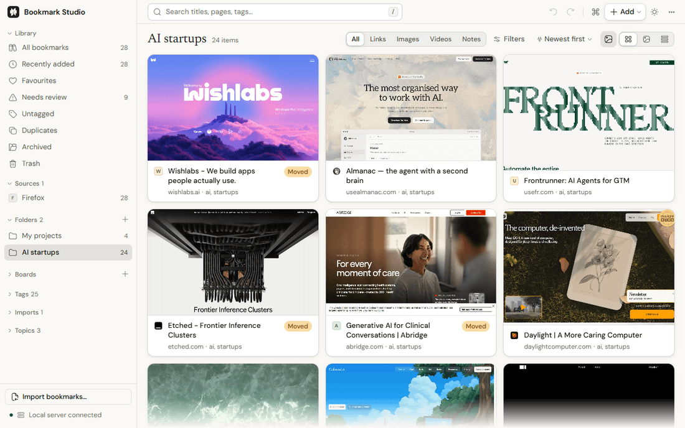

</div>

<br>

## Sound familiar?

You have been saving pages for years. Some are in Chrome, some in Firefox on an old laptop, some in Pocket or Raindrop or a notes app. And when you need one:

- **You can't remember what it was called.** Browser search only reads titles, and you remember what the page was *about*.
- **It's gone.** The site moved or shut down, and you find out the day you need it.
- **It's there three times,** in three folders, under three different names.
- **Everything looks the same.** A wall of blue links and tiny icons gives your memory nothing to hold on to.

So the bookmarks bar turns into a junk drawer, and you stop trusting it. Bookmark Studio is built to make that drawer useful again.

## What it does about it

| When this happens | Bookmark Studio |
| --- | --- |
| Your bookmarks are spread across browsers and apps | Imports from **28 sources**, including every major browser, Pocket, Instapaper, Raindrop, Pinboard, Notion and plain CSV. It shows exactly what will arrive first, and any import can be undone. |
| You remember the idea, not the title | Searches the **text of the page itself**, forgives typos, and understands filters like `site:github.com`, `kind:video` or "saved last month". |
| A list of links tells you nothing | Shows **every page as a preview**, in a grid, masonry or compact list. Only what's on screen is drawn, so big libraries stay smooth. |
| Links have quietly died | **Checks every link**, flags dead and moved pages, and finds the Internet Archive's copy. |
| Duplicates pile up | **Finds and merges duplicates** in one step, and the merge can be undone. |
| You're worried about where your data goes | Keeps your library **in your browser, on your device**. No account, no server holding your bookmarks, no analytics, no AI. |

<table>
<tr>
<td width="50%">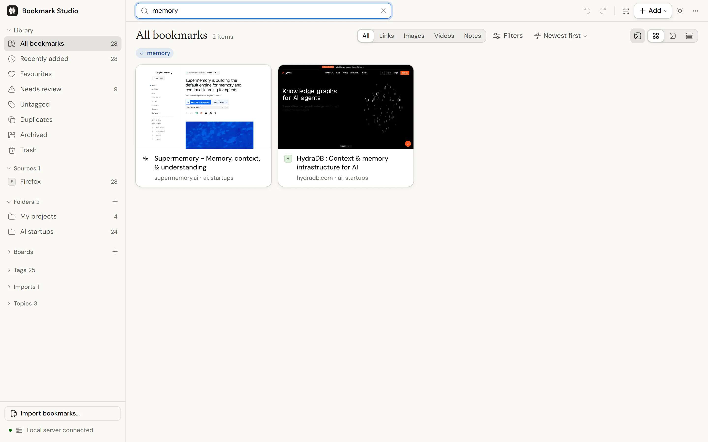</td>
<td width="50%">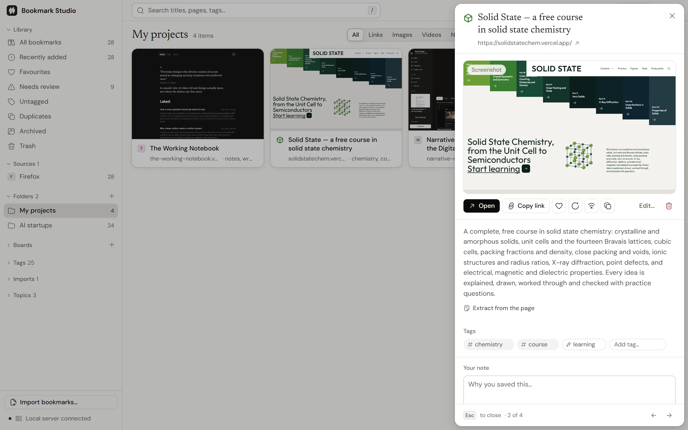</td>
</tr>
<tr>
<td><sub><b>Search what pages say.</b> "agents" finds eight startups, most of which never use the word in their title.</sub></td>
<td><sub><b>Everything about a page in one place:</b> preview, its own description, tags, notes and highlights.</sub></td>
</tr>
</table>

## A real library

Two dozen AI startups saved while reading the news, and a few personal projects. One import, and every page arrived with its picture, its own description and its tags.

<picture>
  <source media="(prefers-color-scheme: dark)" srcset="docs/media/showcase-startups-dark.webp">
  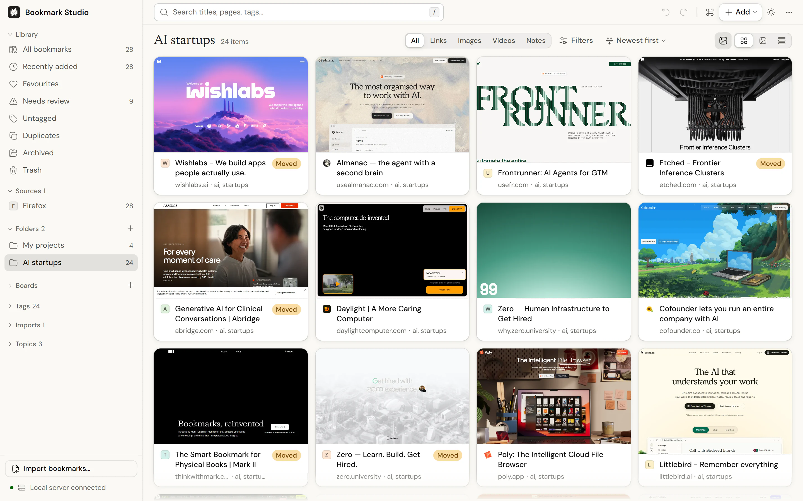
</picture>

<table>
<tr>
<td width="50%">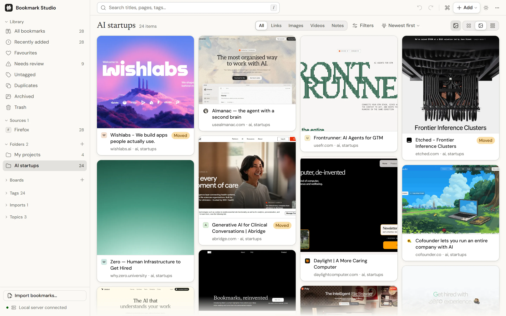</td>
<td width="50%">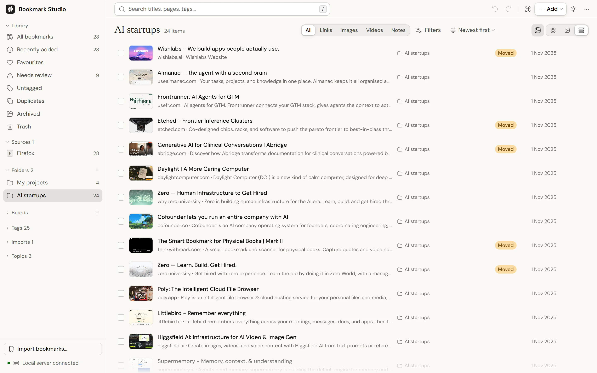</td>
</tr>
<tr>
<td><sub><b>Masonry</b> keeps each picture's shape, like a mood board.</sub></td>
<td><sub><b>List</b> fits more on screen, with each page's own summary. "Moved" marks sites that now redirect.</sub></td>
</tr>
<tr>
<td>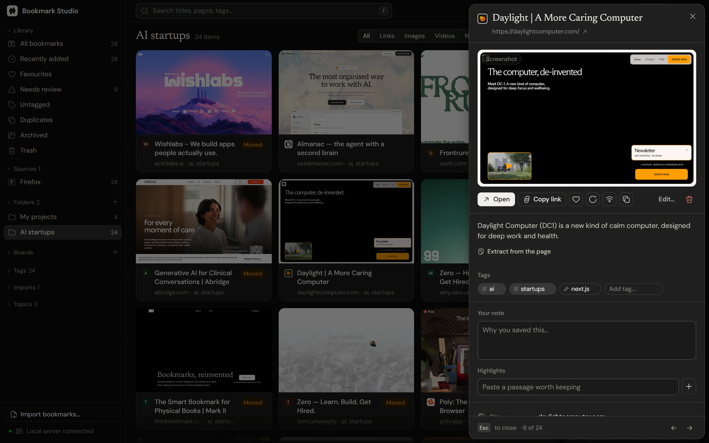</td>
<td>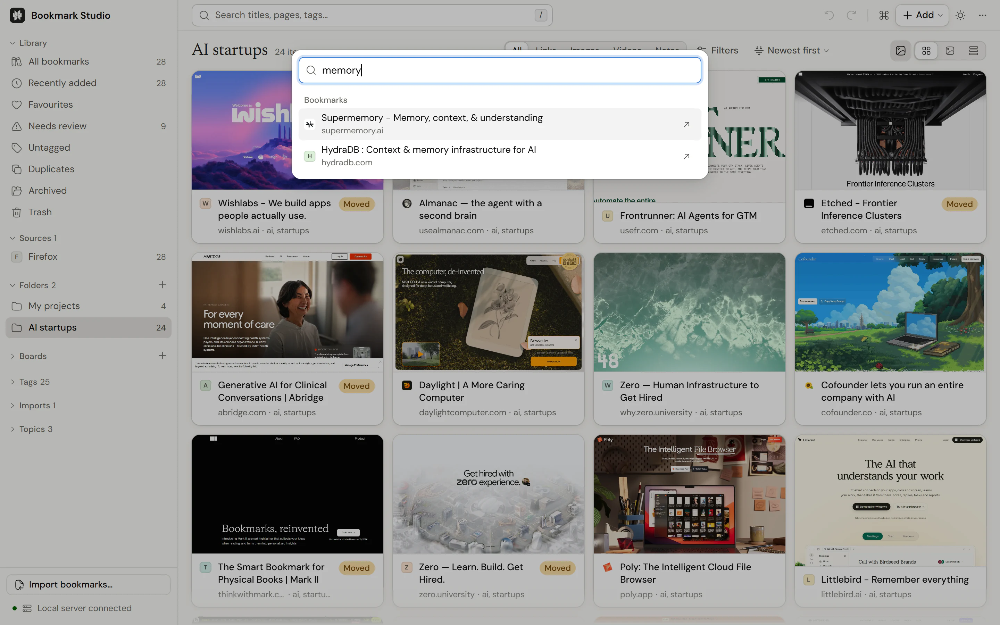</td>
</tr>
<tr>
<td><sub><b>Light and dark,</b> following your system or your choice.</sub></td>
<td><sub><b>The command palette</b> (<code>Ctrl K</code> or <code>⌘ K</code>) jumps to any bookmark, folder or command.</sub></td>
</tr>
</table>

<p align="center">
  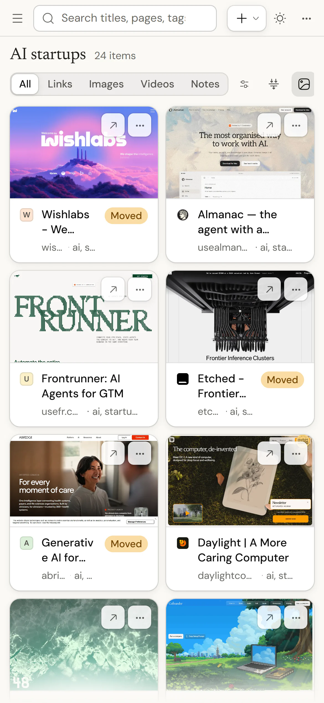
</p>

## Start in a minute

1. **Export your bookmarks.** In Chrome, open the bookmark manager (`Ctrl Shift O`), click **⋮**, then **Export bookmarks**. Every browser has the same option.
2. **[Open Bookmark Studio](https://bookmark-studio-app.vercel.app)** and drop the file anywhere on the page.
3. **Check the preview, import, and search.**

### Or try the sample library first

Not ready to bring your own? Load the **sample library** from the welcome screen: 89 real links across a dozen folders, so you can try everything first. It comes out again in one click.

<p align="center">
  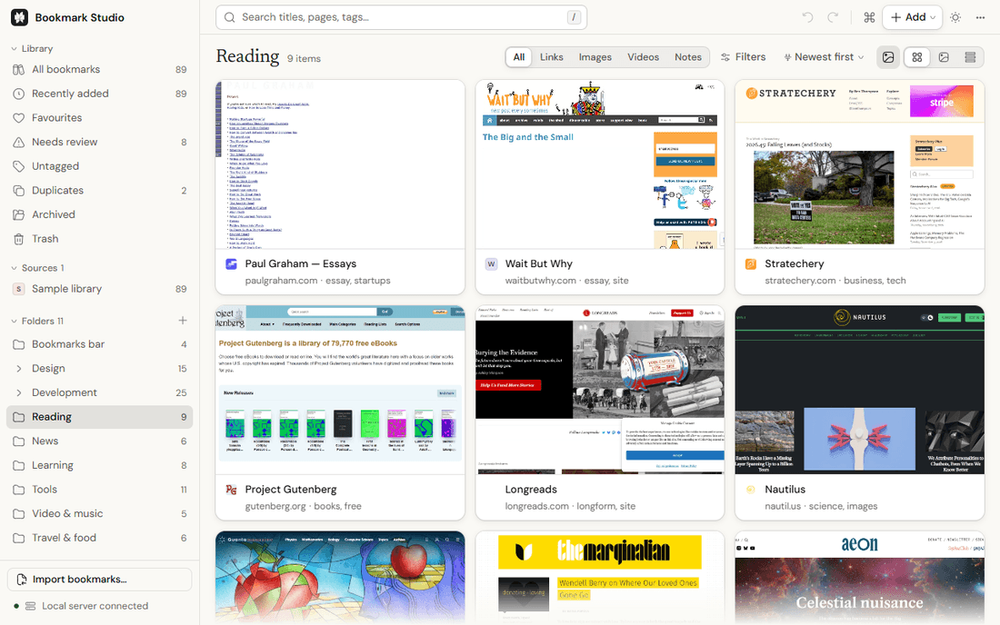
</p>

<table>
<tr>
<td width="50%">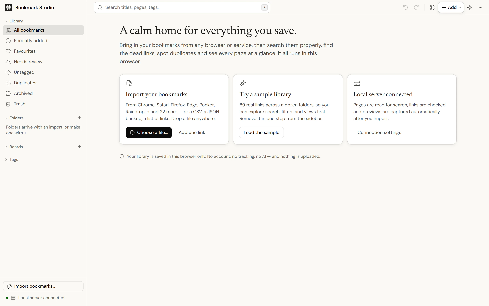</td>
<td width="50%">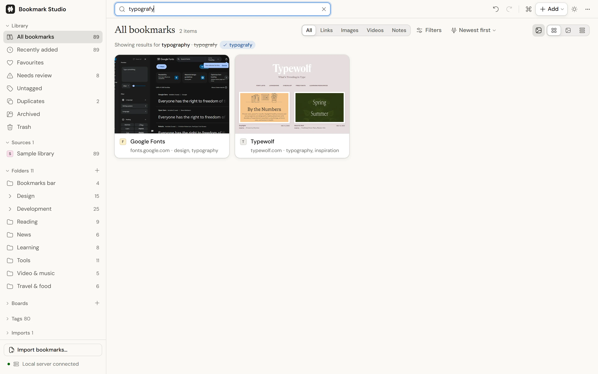</td>
</tr>
<tr>
<td><sub><b>The first screen:</b> import, try the sample, or connect the extension.</sub></td>
<td><sub><b>Typos forgiven.</b> "typografy" finds typography, and it tells you it corrected you.</sub></td>
</tr>
<tr>
<td>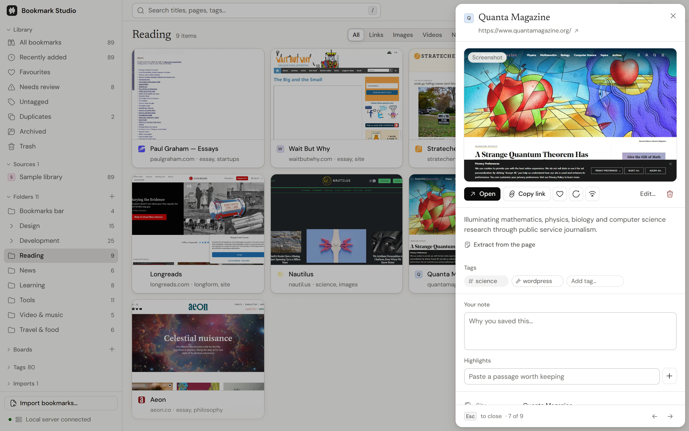</td>
<td>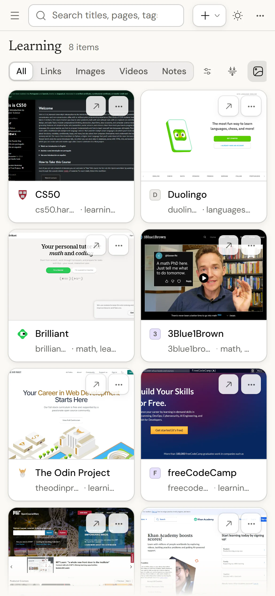</td>
</tr>
</table>

## Three ways to use it

It's the same app every way. Pick whichever suits you.

### The website

Nothing to install. Import, search, organise, tag and export. Install it from the address bar and it works offline like a regular app.

A web page can't read other websites on its own, so page previews, link checks and full-text search need the extension or the local server. The app tells you plainly which one you're using and what each adds.

### The browser extension

For Chrome, Edge, Brave, Arc, Opera, Vivaldi and Firefox 128 or newer. It adds previews, link checks and full-text search, and **keeps your browser's bookmarks in sync both ways**: star a page in Chrome and it appears here; tidy it here and Chrome follows. With the extension installed, the website gets every capability too, and **the website and the extension share one library**.

Installing asks only for your bookmarks. Permission to read the pages in your library is asked for the first time it's needed, so the install prompt doesn't warn about access to every website.

**Chrome, Edge and other Chromium browsers:** [download the extension](https://bookmark-studio-app.vercel.app/bookmark-studio-extension.zip) (also in the app under **Settings → Connections**). Unzip it, open `chrome://extensions`, turn on **Developer mode**, and choose **Load unpacked**.

**Firefox:** [download the Firefox build](https://bookmark-studio-app.vercel.app/bookmark-studio-extension-firefox.zip), open `about:debugging`, choose **This Firefox → Load Temporary Add-on**, and pick the zip. Firefox removes unsigned add-ons when it restarts, so this is for trying it out until a signed version is published.

### On your own computer

Every capability in **any** browser, with previews rendered by headless Chrome or Edge. Needs [Node.js](https://nodejs.org) 22.12 or newer.

```bash
git clone https://github.com/harsh040506/bookmark-studio.git
cd bookmark-studio
npm install
npm start          # opens http://127.0.0.1:5174
```

Or with Docker:

```bash
docker build -t bookmark-studio .
docker run --rm -p 127.0.0.1:5174:5174 bookmark-studio
```

| | Website | Website + extension | Extension | Local server |
| --- | :---: | :---: | :---: | :---: |
| Import, search, organise, export | ✓ | ✓ | ✓ | ✓ |
| Works offline, installable | ✓ | ✓ | ✓ | ✓ |
| Full-text search, link checks | | ✓ | ✓ | ✓ |
| Page previews, offline copies | | ✓ | ✓ | ✓ (headless) |
| Two-way sync with browser bookmarks | | ✓ (on by default) | ✓ | with the extension |
| One library shared with the extension | | ✓ | ✓ | with the extension |
| Firefox | ✓ | ✓ (128+) | ✓ (128+) | ✓ |
| Safari | ✓ | | | ✓ |

## Everything else it does

<picture>
  <source media="(prefers-color-scheme: dark)" srcset="docs/media/library-dark.webp">
  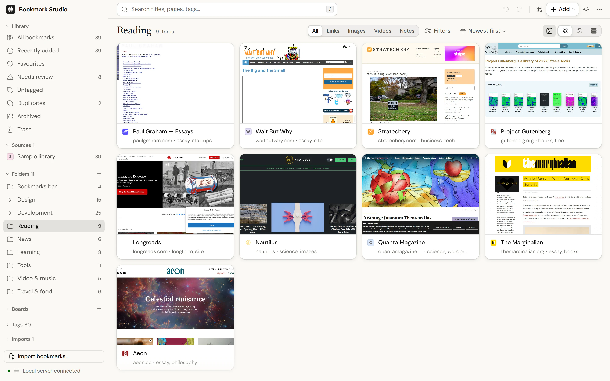
</picture>

- **Organise your way:** folders, boards and tags, plus smart collections that fill themselves from a saved search. A sparkle marks tags found in the page's own words, so you can tell them from the ones you added.
- **Find by look:** search by colour, or find pages that look alike, using image fingerprints.
- **Keep the page itself:** offline copies stay readable with the network off.
- **Notes and highlights** on any bookmark.
- **A command palette** (`Ctrl K` or `⌘ K`) for every bookmark, folder and command, and full keyboard control: press `?` for the shortcuts.
- **Save from your phone:** install the website on Android and share a link to Bookmark Studio from any app.
- **Share without uploading:** export to the standard bookmarks file, JSON or CSV, or share a view as a single web page with the pictures inside.
- **Undo for everything destructive**, and an activity log of what changed.
- **Light and dark themes**, and reduced motion when your system asks for it.

## Private by design

- **Your library never leaves your browser.** It lives in IndexedDB on your device. There's no account, no sync service and no analytics. When the website and the extension share a library, they swap changes inside the browser.
- **The only network requests go to the sites in your library**, and only when you've connected the extension or the local server. They carry no cookies and no referrer.
- **No AI.** Categories come from rules, tags from a list of topics, "similar" from word statistics and "looks like" from image fingerprints. Nothing you save is sent to a model.

The [privacy page](https://bookmark-studio-app.vercel.app/privacy) explains it in plain language, and [SECURITY.md](SECURITY.md) covers the threat model, including how requests to private network addresses are blocked.

## Questions

<details>
<summary><b>Is it really free?</b></summary>

Yes. It's open source under the MIT licence, with no paid tier and no account.
</details>

<details>
<summary><b>What happens if I clear my browser data?</b></summary>

The library is stored by your browser, so clearing this site's data deletes it. Export a backup from **Settings** now and then. It's one file you can import anywhere.
</details>

<details>
<summary><b>Can I use it on more than one device?</b></summary>

Each browser keeps its own library. To move one, export a backup on one device and import it on the other. With the extension, your browser's own bookmark sync (such as Chrome sync) carries your bookmarks between devices.

Within one browser, the website and the extension share a library: while the extension is connected, changes on either side appear on the other.
</details>

<details>
<summary><b>Can I get my bookmarks out again?</b></summary>

Always. Export to the standard bookmarks HTML file that every browser imports, a complete JSON backup, or CSV.
</details>

<details>
<summary><b>How big a library can it handle?</b></summary>

It's tested with real browser exports of over 1,300 links, which import in a few seconds. The grid only draws what's on screen, so much larger libraries stay smooth, and preview capture never loads more than five pages at once.
</details>

## For developers

```bash
npm install
npm run dev          # app + local API at http://localhost:5173, with hot reload
npm test             # unit tests
npm run check        # TypeScript, client and server
npm run build        # dist/web, dist/extension and dist/extension-firefox (+ zips), dist/server
npm run check:site   # the public pages: tags, links, sitemap, structured data, size budgets
npm run test:smoke   # loads the built extension and website in a real Chrome and drives both
```

- **Stack:** React 19, Vite 7, TypeScript, Radix primitives and Tailwind for layout; Express and puppeteer-core for the local server. No server framework, no database.
- **Design:** one design system throughout, in [`src/styles`](src/styles), summarised in [docs/DESIGN.md](docs/DESIGN.md). Type is DM Sans, Newsreader and JetBrains Mono; icons are Hugeicons.
- **Architecture:** how one codebase runs as a website, an extension and a local server is in [docs/ARCHITECTURE.md](docs/ARCHITECTURE.md). Notes for coding agents are in [AGENTS.md](AGENTS.md).
- **The public pages** (about, privacy, llms.txt, sitemap) are generated from [`site/content.mjs`](site/content.mjs) at build time. Pictures of the app are re-shot from the real thing with `npm run media`.
- **Hosting your own copy:** `npm run build:web` produces a static site in `dist/web`. `vercel.json` is included, so importing the repository into Vercel needs no settings. Set `SITE_URL` to your address so links, previews and the sitemap point at your copy (Vercel's production address is picked up automatically). [docs/HOSTING.md](docs/HOSTING.md) covers the host rules, rollbacks and refreshing link previews.

### Configuration (local server)

All optional.

| Variable | Default | Purpose |
| --- | --- | --- |
| `PORT` | `5174` | Server port |
| `HOST` | `127.0.0.1` | Bind address. Read [SECURITY.md](SECURITY.md) before changing it |
| `ALLOWED_HOSTS` | loopback only | Extra host names the API answers to (comma-separated), for a self-hosted domain or LAN address |
| `CHROME_PATH` | auto-detected | Chrome, Edge or Chromium for screenshots |
| `SCREENSHOT_CACHE_DIR` | `.cache/screenshots` | Where rendered previews are cached |
| `SCREENSHOT_CONCURRENCY` | `3` | Pages loaded at once in the single headless browser (1–5; never more than 5) |
| `SCREENSHOT_RECYCLE_AFTER` | `150` | Captures before the headless browser is closed and restarted, to keep memory flat on long runs |
| `SCREENSHOT_CACHE_MAX_BYTES` | `536870912` (512 MB) | Disk ceiling for the preview cache |
| `LOG_LEVEL` | `info` | `debug`, `info`, `warn` or `error`. Logs are one JSON object per line, with web addresses cut to the site name |
| `NO_OPEN` | unset | Set to `1` to stop `npm start` opening a browser |
| `SITE_URL` | Vercel's address | Build time: the public address used in canonical links, previews and the sitemap |

## Contributing

Bug reports, ideas and pull requests are welcome. Read [CONTRIBUTING.md](CONTRIBUTING.md) first, and report security problems privately as described in [SECURITY.md](SECURITY.md).

## Licence

[MIT](LICENSE). Use it, change it, share it.
