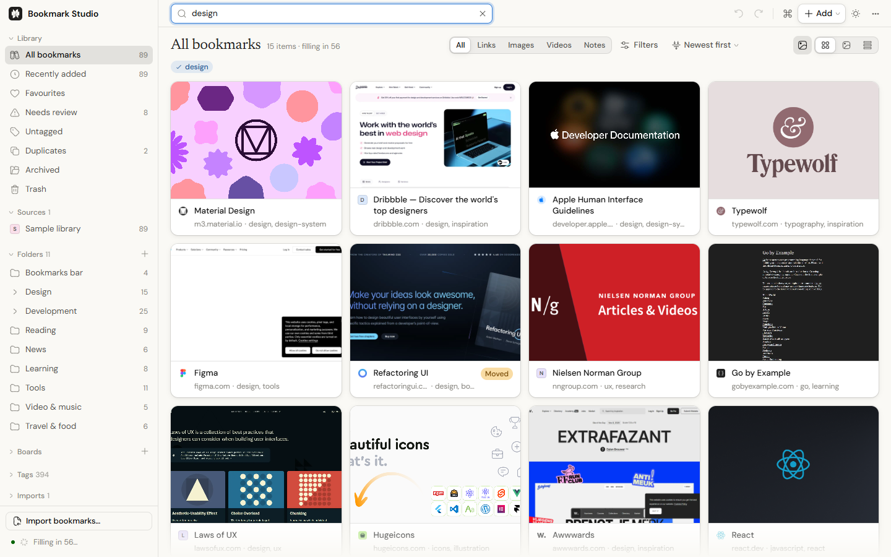
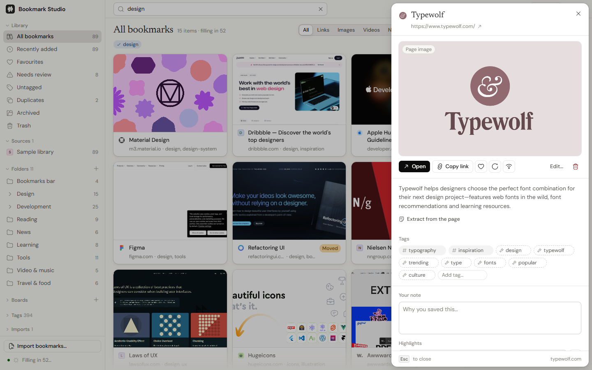
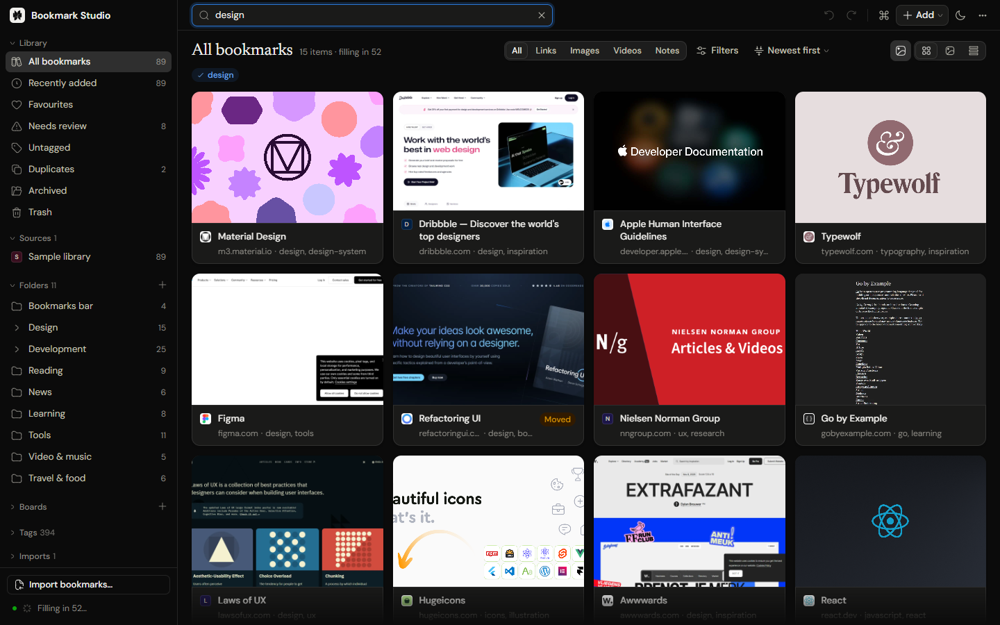
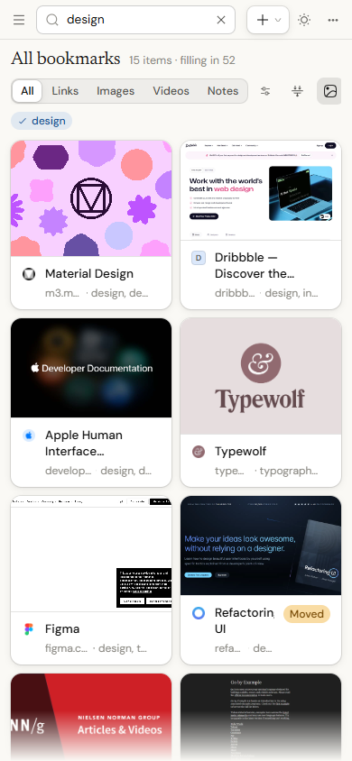
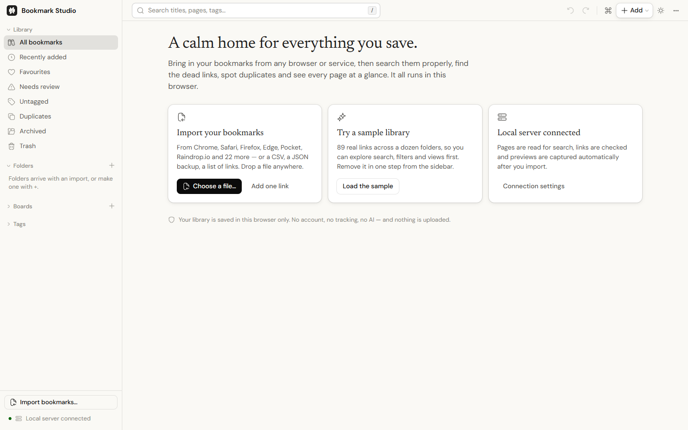

<div align="center">


# Bookmark Studio

**A calm home for everything you save.**

Bring in your bookmarks from any browser or service, then search them properly, find the dead links,
spot duplicates and see every page at a glance. Free, open source, and private: it runs in your browser.

No account · No tracking · No AI · MIT licensed

[**Open the app**](https://bookmark-studio-app.vercel.app) · [Get the extension](#2-the-chrome-extension) · [Run it locally](#3-on-your-own-computer) · [How it works](docs/ARCHITECTURE.md)

</div>



---

## Three ways to use it

Pick whichever suits you. It's the same app every way.

### 1. The website: nothing to install

Open the app in any modern browser and start right away:

- **Import** your bookmarks (drop the file anywhere), or **try the sample library** first.
- Search, filter, tag, file into folders and boards, save smart collections, export.
- **Install it** as an app from the address bar (it's a PWA), and it keeps working offline.

On its own, a web page can't read other websites, so page previews, link checks and "read the page for search" stay off until you add the extension or run it locally. The app says so plainly and shows you how.

### 2. The Chrome extension

For Chrome, Edge, Brave, Arc, Opera and Vivaldi. The extension:

- **mirrors your browser's bookmarks both ways**: star a page in Chrome and it appears; edit it here and Chrome follows;
- **captures previews, reads pages and checks links** automatically;
- **powers the website too.** With the extension installed, the website gets every capability, and can optionally sync with the browser's bookmarks.

**Install:** download the extension from the app's **Settings → Connections**, or get `bookmark-studio-extension.zip` from the [latest release](https://github.com/harsh040506/bookmark-studio/releases/latest). Unzip it, open `chrome://extensions`, turn on **Developer mode**, and click **Load unpacked**. When the extension is used with a copy of the app running on your own computer, it asks once before that address can use it.

### 3. On your own computer

Every capability in **any** browser. Previews are rendered in headless Chrome or Edge, with no capture windows. You need [Node.js](https://nodejs.org) 20 or newer.

```bash
git clone https://github.com/harsh040506/bookmark-studio.git
cd bookmark-studio
npm install
npm start
```

`npm start` builds everything the first time, then opens **http://127.0.0.1:5174**. Prefer Docker?

```bash
docker build -t bookmark-studio .
docker run --rm -p 127.0.0.1:5174:5174 bookmark-studio
```

| | Website | Website + extension | Extension | Local server |
| --- | :---: | :---: | :---: | :---: |
| Import, search, organise, export | ✓ | ✓ | ✓ | ✓ |
| Works offline, installable | ✓ | ✓ | ✓ | ✓ |
| Read pages for search, check links | | ✓ | ✓ | ✓ |
| Screenshot previews, offline copies | | ✓ | ✓ | ✓ (headless) |
| Two-way sync with browser bookmarks | | ✓ (opt-in) | ✓ | with the extension |
| Any browser (Firefox, Safari) | ✓ | | | ✓ |

---

## What it does

<table>
<tr>
<td width="50%"></td>
<td width="50%"></td>
</tr>
</table>

**Bring everything in.** Imports from **28 sources**:

- browsers: Chrome, Edge, Brave, Opera, Vivaldi, Chromium, Arc, DuckDuckGo, Samsung Internet, Firefox, Safari, iCloud;
- read-later services: Pocket, Instapaper, Readwise Reader;
- bookmarking services: Raindrop.io, Pinboard, Delicious, Diigo, Google Bookmarks, X;
- notes and archives: Notion, Evernote;
- plain files: HTML, CSV (with column mapping), JSON, a list of links, and its own backups.

The source is detected, you preview exactly what will be imported, and every import can be undone or removed in one step later. Folder structure, dates, tags and your own ordering all carry over.

**Find anything.**

- Search that forgives typos ("clipbord" finds the clipboard manager) and tells you when it corrected one.
- Operators: `tag:` `site:` `is:dead` `has:offline` `kind:video` `color:blue` `before:`.
- Plain English: "saved last month", "never opened", "older than a year".
- A command palette (`Ctrl/⌘ K`) for bookmarks, places and every command.

**See every page.**

- Screenshot previews and page images in a grid, masonry or dense list, windowed so 100,000 bookmarks scroll smoothly.
- "Looks like" and search by colour, using perceptual hashes; no model involved.

**Keep it healthy.**

- Link checks flag dead, moved and blocked pages, with Wayback Machine fallbacks.
- Duplicates are detected and merged in one undoable step, and duplicate pictures too.
- Offline copies keep the page itself, readable with the network off.

**Organise your way.**

- Folders, boards and tags. A sparkle marks tags found in the page's own words, so you can tell them from yours.
- Smart collections that fill themselves from a saved search.
- Notes and highlights.

**Share without uploading.** Export to the browser's HTML format, a complete JSON backup or CSV, or **share a view as a single self-contained web page** with the pictures inside.

**Considerate by default.**

- Undo for everything destructive, and an activity log.
- System, Light and Dark themes, with reduced motion when you ask for it.
- Fully keyboard-operable: press `?` for the shortcuts.

<p align="center"> &nbsp; </p>

---

## Privacy

- **Your library never leaves your browser.** It's stored in IndexedDB on your device. There is no account, no sync service and no analytics.
- **The only network requests go to the sites in your library**, and only when the extension or the local server is connected. They're sent without cookies and without a referrer.
- **No AI.**
  - Categories come from rules and tags from term statistics.
  - "Similar" uses TF-IDF and "looks like" uses perceptual hashing.
  - Typo correction draws on your own library's vocabulary, and descriptions come from the pages themselves.

Details, including how private network addresses are blocked, are in [SECURITY.md](SECURITY.md).

---

## For developers

```bash
npm install
npm run dev          # app + local API at http://localhost:5173, with hot reload
npm test             # 400+ unit tests
npm run check        # TypeScript, client and server
npm run build        # dist/web, dist/extension (+ zip), dist/server
npm run test:smoke   # loads the built extension and website in a real Chrome and drives both
```

- **Stack:** React 19, Vite 7, TypeScript, Radix primitives, Tailwind for layout, Express and puppeteer-core for the local server. No framework on the server, no database.
- **Design:** one design system throughout. The tokens and components live in [`src/styles`](src/styles), typography is DM Sans, Newsreader and JetBrains Mono, and icons are Hugeicons. [docs/DESIGN.md](docs/DESIGN.md) summarises the rules.
- **Architecture:** how one codebase runs as a website, an extension and a local server, and how the extension bridge works, is in [docs/ARCHITECTURE.md](docs/ARCHITECTURE.md).
- **Hosting your own copy:** `npm run build:web` produces a static site in `dist/web` for any static host. A `vercel.json` is included, so importing the repository into Vercel works with no settings. To let the extension serve your copy, build it with `SITE_URL` set to your address (on Vercel this is picked up automatically).

### Configuration (local server)

All optional.

| Variable | Default | Purpose |
| --- | --- | --- |
| `PORT` | `5174` | Server port |
| `HOST` | `127.0.0.1` | Bind address. Read [SECURITY.md](SECURITY.md) before changing it |
| `ALLOWED_HOSTS` | loopback only | Extra host names the API answers to (comma-separated), for a self-hosted domain or LAN address |
| `CHROME_PATH` | auto-detected | Chrome, Edge or Chromium for screenshots |
| `SCREENSHOT_CACHE_DIR` | `.cache/screenshots` | Where rendered previews are cached |
| `SCREENSHOT_CONCURRENCY` | `3` | Pages loaded at once in the single headless browser (1–5; never more than 5) |
| `SCREENSHOT_RECYCLE_AFTER` | `150` | Captures before the headless browser is closed and restarted, to keep memory flat on long runs |
| `SCREENSHOT_CACHE_MAX_BYTES` | `536870912` (512 MB) | Disk ceiling for the preview cache |
| `LOG_LEVEL` | `info` | `debug`, `info`, `warn` or `error`. Logs are one JSON object per line, with web addresses cut to the site name |
| `NO_OPEN` | unset | Set to `1` to stop `npm start` opening a browser |

Contributions are welcome. Read [CONTRIBUTING.md](CONTRIBUTING.md) first.

## License

[MIT](LICENSE). Use it, change it, ship it.
